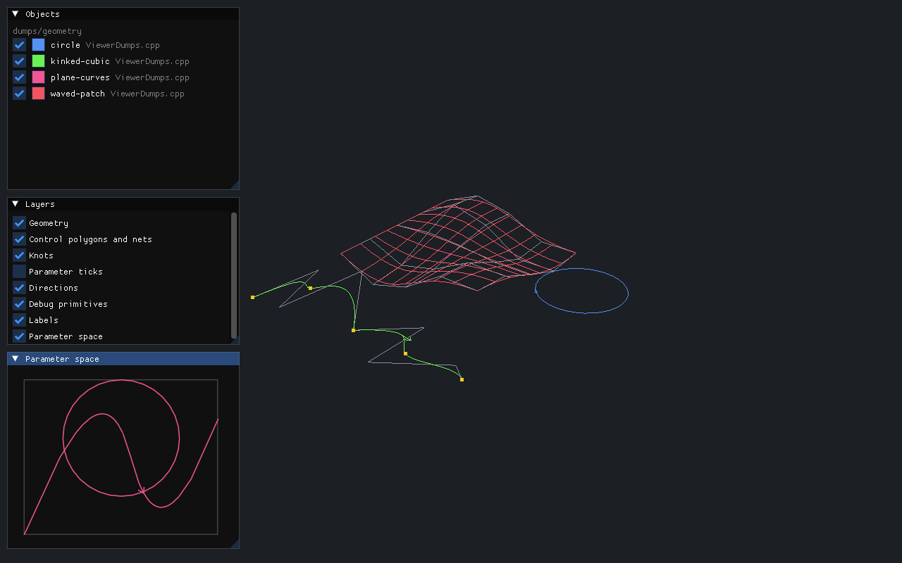
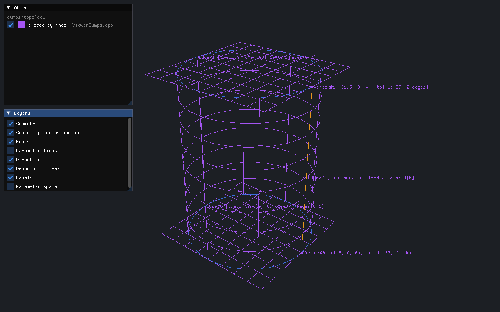

.. SPDX-FileCopyrightText: 2026 Onur Tuncer and Stereon contributors
.. SPDX-License-Identifier: MPL-2.0
..
.. This Source Code Form is subject to the terms of the Mozilla Public
.. License, v. 2.0. If a copy of the MPL was not distributed with this
.. file, You can obtain one at https://mozilla.org/MPL/2.0/.

Debugging
=========

Index handles, type-erased geometry and copy-on-write pages are opaque to a
debugger that shows raw members: a handle is a bare integer, a ``Curve`` is
96 bytes of buffer and a pointer, a ``PagedArena`` a vector of shared
pointers. ADR-0004 therefore makes pretty-printers part of the design, and
``tools/debugger/`` provides them for GDB and LLDB.

Loading the printers
--------------------

GDB, in a session or in ``~/.gdbinit``:

.. code-block:: text

   source /path/to/Stereon/tools/debugger/stereon_gdb.py

LLDB, in a session or in ``~/.lldbinit``:

.. code-block:: text

   command script import /path/to/Stereon/tools/debugger/stereon_lldb.py

In Visual Studio Code with the C/C++ extension and GDB, add the ``source``
line to ``setupCommands`` in ``launch.json``:

.. code-block:: json

   "setupCommands": [
       { "text": "source ${workspaceFolder}/tools/debugger/stereon_gdb.py" }
   ]

What they show
--------------

Every value prints as Stereon's own ``std::format`` output does, so a
debugger session, a log line and a test failure read alike:

=========================  =======================================================================
Type                       Example
=========================  =======================================================================
``Vec3``, ``Point2``       ``(1, 2.5, -3)``
``Interval``               ``[1, 2]``, ``[]`` when empty
``Box3``                   ``[(0, 0, 0), (1, 2, 3)]``
``VertexId``               ``Vertex#12``, ``Edge#-`` when invalid
``BuilderId``              ``Face#0@0`` (index and generation)
``Oriented``               ``Coedge#42 (reversed)``
``Curve``, ``Surface``     ``Curve(Circle) {Center = (1, 2, 3), Radius = 2.5, ...}``
user geometry              ``Curve((anonymous namespace)::UserCurve) {Base = {...}}``
large geometry             ``Curve(BSplineCurve, shared) {...}``, held behind the shared pointer
``PagedArena``             ``PagedArena of 6 entries in 2 pages, 1 shared``; GDB lists the entries
``JournalId``              ``J#7``
``Sign``, ``Expansion``    ``Negative``, ``Expansion [1, 2]``
=========================  =======================================================================

In a build with checked handles (the debug and sanitizer presets), a handle
of a live shape shows the entity it names, as ``Describe()`` does:

.. code-block:: text

   (gdb) print edge
   $1 = Edge#0 [Spatial Line, tol 1e-07, faces none]

Each frozen snapshot registers its store while it is alive, and the
printers call ``stereon_describe_handle(kind, index, store)`` in the
process. With no live process (a core file), a handle of a release build,
which carries no store, or a snapshot that is gone, the handle shows its
index, ``Edge#0``.

How they work
-------------

Two details of the GCC 16 module build shape the printers. Type names carry
the module they belong to, ``Stereon::Interval@Stereon.Core``, which the
printers' matchers allow and strip. And a ``Curve`` or ``Surface`` holds its
value in a model whose dynamic type neither debugger resolves by itself: the
vtable names template arguments as ``3ull`` where the debug information says
``3``, and LLDB's demangler does not understand GCC's module mangling at all.
The printers read the model's vtable symbol, demangling it with binutils'
``c++filt`` under LLDB, take the wrapped type's name from the model's template
arguments, look that type up, and read the value just past the vtable
pointer, or through the shared pointer for a type too large for the buffer.

Both printers implement the same formatting rules, and
``tests/debugger/check_printers.py`` holds them to one expected table: it runs
``tests/debugger/DebuggerTarget.cpp`` under each debugger in batch mode,
stops in ``StereonDebuggerStop()``, prints every variable and compares. CTest
runs it as ``tools: gdb pretty-printers`` and ``tools: lldb pretty-printers``
in Debug builds, and reports a debugger that is not installed as skipped;
the Linux CI jobs install both. A change to a type's layout that breaks a
printer fails these tests.

Contract violations and journals
--------------------------------

Checked handles (``STEREON_CHECKED_HANDLES``, on in the debug presets) report
a stale or foreign handle with the handle, its store and the slot's state
before raising a contract violation. Evaluator, arena and predicate-domain
violations print the function and the problem the same way. A breakpoint on
``handle_contract_violation`` stops at any of them. The operation journal of
ADR-0023 records what an operation was called with, so a failure can be
replayed in isolation.

Dumps
-----

A dump puts an object in a file for the debug viewer (ADR-0035). It is an
ordinary ``.stn`` archive, ``$STEREON_DUMP_DIR/<name>.stn``, with an optional
``DBUG`` chunk that records the dump's name, the file, line and time of the
call, and debug primitives: points, polylines, boxes, triangle soups and
labels, each with an optional colour. When ``STEREON_DUMP_DIR`` is unset, a
dump writes nothing and costs one environment lookup. A dump of the same
name replaces the earlier one. The file is written to a temporary name and
renamed, so a reader never sees half of it.

.. code-block:: cpp

   #include <Stereon/Io/Dump.hpp>
   import Stereon.Io;

   STEREON_DUMP("after-knot-insertion", curve);  // a Curve, Curve2d, Surface or Shape
   STEREON_DUMP("probe", primitives);            // a DebugChunk of primitives alone

``STEREON_DUMP`` records the call site and ignores errors. ``Stereon::DumpAt``
returns the path written, or the error. From a debugger, call the
out-of-line overloads, which return ``true`` when a file was written:

.. code-block:: text

   (gdb) call Stereon::Dump("edge", *curve)

A ``Shape`` is dumped through ``ShapeArchive`` until the native format has
topology chunks. The archive holds the surface of every face, the curve of
every edge trimmed to its range and the pcurve of every coedge. Its debug
primitives are the topology overlays:

- every vertex, with its tolerance drawn as a box;
- every edge as a polyline coloured by its curve kind (``EdgeCurveColour``);
- a ``Describe()`` label at every vertex and at the middle of every edge.

Display sampling, ``Stereon.Mesh:Sampling``, turns curves into polylines
and surfaces into iso-lines. Its ``DisplayTolerance`` (chord and angle)
serves display only and never reaches modelling code. B-spline polylines
pass through every distinct knot. Unbounded geometry is drawn over a range
that the caller supplies.

stn-dump
--------

``stn-dump`` prints any ``.stn`` file, dumps included, as JSON: the header,
the policy and every chunk with its records and primitives. With
``--pretty`` it prints one member per line and keeps flat arrays on one
line, so two versions of a file diff line by line:

.. code-block:: sh

   stn-dump --pretty before.stn > before.json
   stn-dump --pretty after.stn > after.json
   diff before.json after.json

It is built with the kernel unless ``STEREON_BUILD_TOOLS=OFF``.

The debug viewer
----------------

``stn-view`` shows the dumps of a directory and reloads them when they
change, so a dump made in a running test or a debugger session appears
within a second. Configure with ``-DSTEREON_BUILD_VIEWER=ON``. It needs
GLFW, OpenGL 3.3 and Dear ImGui, which only the viewer may link
(ADR-0035):

.. code-block:: sh

   STEREON_DUMP_DIR=/tmp/dumps ctest -R my-test
   stn-view /tmp/dumps        # or no argument: $STEREON_DUMP_DIR

- Left drag orbits, right or middle drag pans, the wheel zooms, and ``F``
  fits everything in view.
- The **Objects** window lists every dump with its visibility, colour, name
  and source location. Selecting a row highlights the object. A file that
  does not load is listed with its error.
- The **Layers** window shows or hides geometry, control polygons and nets,
  knots, parameter ticks, direction arrows, debug primitives and labels.
- The **Parameter space** window draws plane curves and pcurves.

Curves and surfaces are sampled for display (``Stereon.Mesh:Sampling``).
Unbounded geometry, such as a line, a plane or a cylinder, is drawn around
the bounded content of the scene. The scene behind the window,
``viewer/scene``, is headless and tested without a window, so other
frontends can reuse it.

   Geometry dumps. The cubic has a knot of multiplicity three at its
   middle, and the polyline keeps the kink. The control polygon is grey
   and the knots are yellow. The patch is drawn as iso-lines over its
   control net. Arrows show the direction of each curve's parameter. The
   two plane curves are in the Parameter space window.

   A ``Shape`` dump: the closed cylinder of the topology tests. Each face
   is drawn over the parameter box of its boundary. The edges are
   coloured by kind: the seam in orange (``Boundary``) and the circles in
   blue (``Exact``). Vertices and edges carry their ``Describe()`` labels.

``stn-view --screenshot file.png`` renders the window once, writes it as a
PNG and exits. The figures above come from the Linux viewer CI job: it
writes the dumps of ``docs/figures/ViewerDumps.cpp`` and renders them under
Xvfb with Mesa's software OpenGL.

Related design decisions
------------------------

- `ADR-0003: Geometry polymorphism via external polymorphism <https://github.com/onurtuncer/Stereon/blob/main/docs/adr/0003-geometry-polymorphism.md>`_
- `ADR-0004: Topology storage and handles <https://github.com/onurtuncer/Stereon/blob/main/docs/adr/0004-topology-storage-and-handles.md>`_
