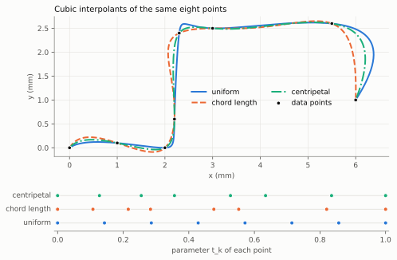
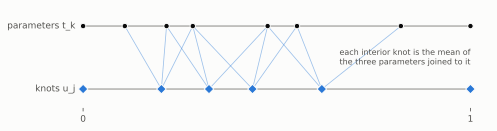
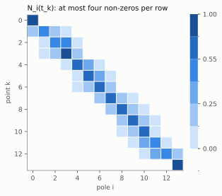
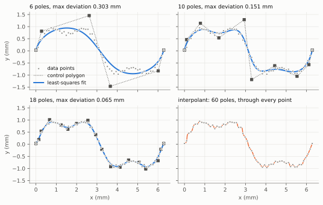
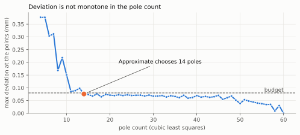
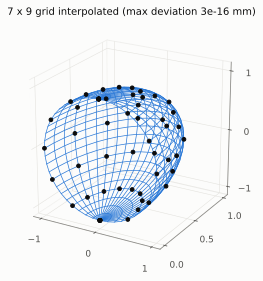

.. SPDX-FileCopyrightText: 2026 Onur Tuncer and Stereon contributors
.. SPDX-License-Identifier: MPL-2.0
..
.. This Source Code Form is subject to the terms of the Mozilla Public
.. License, v. 2.0. If a copy of the MPL was not distributed with this
.. file, You can obtain one at https://mozilla.org/MPL/2.0/.

Fitting curves and surfaces
===========================

Measured profiles, scanned sections, points from another kernel's
tessellation, sample points of a user-defined surface: much geometry
arrives as points, and a modelling kernel has to turn points into B-splines.
This chapter derives the fitting functions of ``Stereon.Curve`` and
``Stereon.Surface``, following chapter 9 of Piegl and Tiller
:cite:p:`piegl1997nurbs` and the spline theory of de Boor
:cite:p:`deboor2001practical`:

- ``Interpolate`` builds the curve of a given degree through every point;
- ``FitLeastSquares`` builds the curve with a given number of poles that is
  closest to the points in the least-squares sense;
- ``Approximate`` searches for the fewest poles whose least-squares fit meets
  an ``ApproximationBudget``;
- ``InterpolateSurface`` builds the surface through a grid of points.

Every figure in this chapter is drawn from what Stereon computes:
``docs/figures/FigureData.cpp`` prints the data and
``docs/figures/make_fitting_figures.py`` renders it, so the figures cannot
drift from the code.

The fitting problem
-------------------

Given points :math:`Q_0, \dots, Q_m` and a degree :math:`p`, we look for a
clamped B-spline curve

.. math::

   C(t) = \sum_{i=0}^{n} N_{i,p}(t)\, P_i, \qquad t \in [0, 1],

that passes through the points or near them. Three choices determine the
answer, in this order: which parameter :math:`t_k` each point gets, which
knot vector the basis functions :math:`N_{i,p}` are built on, and how the
poles :math:`P_i` are computed from the first two. The poles enter linearly,
so once the parameters and knots are fixed, fitting is linear algebra; the
first two choices are where the geometry is decided.

The fitted curves are polynomial B-splines. Weights would make the problem
non-linear, and a polynomial spline of moderate degree approximates any
smooth curve well; exact conics come from :doc:`nurbs` instead.

Parameters for the points
-------------------------

A curve through the points visits them in order, but nothing in the points
says *when*. The parametrisation decides, and it shapes the curve more than
any other choice (:numref:`fig-fitting-parametrization`). With the chord
lengths :math:`d_k = \norm{Q_k - Q_{k-1}}` and :math:`t_0 = 0`, Stereon
offers three rules (``Parametrization``):

.. math::

   \text{uniform:}\quad t_k = \frac{k}{m}, \qquad
   \text{chord length:}\quad t_k = \frac{\sum_{j \le k} d_j}{\sum_{j \le m} d_j}, \qquad
   \text{centripetal:}\quad t_k = \frac{\sum_{j \le k} \sqrt{d_j}}{\sum_{j \le m} \sqrt{d_j}}.

Chord length, the default, makes the parameter roughly proportional to arc
length, so the curve's speed is nearly constant and it does not bulge
between points that are far apart. Uniform parameters ignore the spacing:
where long and short chords alternate the curve must hurry through the
long ones, and it overshoots. Centripetal parameters, proposed by Lee
:cite:p:`lee1989choosing`, take the square root of each chord, which damps
the acceleration around sharp turns; the figure shows it hugging the corner
that chord length rounds off and uniform overshoots.

.. _fig-fitting-parametrization:

   The same eight points interpolated by cubics under the three rules. Below,
   the parameter each rule gives each point: uniform spacing ignores the
   long vertical chord, so its curve rushes through it and swings wide at
   the right end; chord length follows the spacing exactly; centripetal sits
   in between.

Chord length and centripetal parameters are undefined when two consecutive
points coincide (a zero chord makes two parameters equal and the fitting
system singular), so ``Interpolate`` rejects such input with
``InvalidInput``; uniform parameters accept it.

Knots by averaging
------------------

With the parameters fixed, the knot vector has to make the interpolation
problem solvable. For :math:`m + 1` points and degree :math:`p` the curve has
:math:`n + 1 = m + 1` poles, so the clamped knot vector has
:math:`m + p + 2` knots: :math:`p + 1` zeros, :math:`m - p` interior knots and
:math:`p + 1` ones. Stereon places the interior knots by averaging
:math:`p` consecutive parameters (eq. 9.8 of :cite:p:`piegl1997nurbs`),

.. math::

   u_{j+p} = \frac{1}{p} \sum_{i=j}^{j+p-1} t_i, \qquad j = 1, \dots, m - p
   \quad (\text{``Detail::AveragedKnots''}),

shown in :numref:`fig-fitting-knot-averaging`.

.. _fig-fitting-knot-averaging:

   Chord-length parameters of the eight points above (top) and the knots of
   the cubic interpolant (bottom). Every interior knot is the mean of three
   consecutive parameters, so the knots follow the spacing of the data.

Averaging is not arbitrary: it guarantees that the interpolation matrix is
non-singular. The **Schoenberg–Whitney theorem**
:cite:p:`schoenberg1953polya` states that the collocation matrix
:math:`A_{ki} = N_{i,p}(t_k)` of distinct parameters is non-singular if and
only if every diagonal entry is non-zero, that is,

.. math::

   u_k < t_k < u_{k+p+1} \qquad \text{for every interior } k,

each parameter lies in the support of "its" basis function. With averaged
knots, :math:`u_k` is the mean of :math:`t_{k-p}, \dots, t_{k-1}`, all
smaller than :math:`t_k`, and :math:`u_{k+p+1}` the mean of
:math:`t_{k+1}, \dots, t_{k+p}`, all larger; so the conditions hold by
construction whenever the parameters strictly increase, which is why zero
chords are rejected.

The collocation system
----------------------

The interpolation conditions :math:`C(t_k) = Q_k` are the linear system

.. math::

   \sum_{i=0}^{m} N_{i,p}(t_k)\, P_i = Q_k, \qquad k = 0, \dots, m,

one system per coordinate with the same matrix. Its structure follows from
local support: row :math:`k` has non-zeros only in the :math:`p + 1` columns
of the span containing :math:`t_k`, and with averaged knots that span lies
within :math:`p` of the diagonal, so the matrix is **banded** with
half-bandwidth :math:`p` (:numref:`fig-fitting-collocation`).

.. _fig-fitting-collocation:

   The collocation matrix :math:`N_i(t_k)` of a cubic interpolation of 14
   points. Each row holds at most four non-zeros, the basis functions of one
   span, which sum to 1; the first and last rows are unit rows because the
   curve is clamped.

The matrix is also **totally positive**: every minor is non-negative
(Karlin; see :cite:p:`deboor2001practical`, chapter XIII). For totally
positive matrices Gaussian elimination *without pivoting* is numerically
stable (de Boor and Pinkus), so ``Detail::InterpolatingPoles`` eliminates
inside the band without row exchanges, which would widen it. The cost is
:math:`O(m p^2)`: linear in the number of points.

Two properties of the result are worth knowing.

**Reproduction.** If the points lie on a curve that belongs to the spline
space, for instance a cubic polynomial sampled at its own parameters,
interpolation returns that curve exactly, because the system has a unique
solution and the curve is one. ``tests/curve/FittingTests.cpp`` checks this
with :math:`(t, t^2 - t, 2t^3)`.

**Clamped ends.** The first and last rows are
:math:`N_{0,p}(0) = 1` and :math:`N_{m,p}(1) = 1`, so :math:`P_0 = Q_0` and
:math:`P_m = Q_m`: the curve starts and ends exactly at the end points.

Interpolation passes through every point, and that is its weakness for
noisy data: every bump in the measurements becomes a bump in the curve
(:numref:`fig-fitting-least-squares`, last panel).

Least-squares approximation
---------------------------

With fewer poles than points, :math:`n < m`, the curve cannot pass through
every point, and ``FitLeastSquares`` asks for the curve closest to them in
the least-squares sense, with the ends still exact
(:cite:p:`piegl1997nurbs`, section 9.4.1). Fixing :math:`P_0 = Q_0` and
:math:`P_n = Q_m`, the interior poles :math:`P_1, \dots, P_{n-1}` minimise

.. math::

   f(P_1, \dots, P_{n-1}) = \sum_{k=1}^{m-1} \norm{Q_k - C(t_k)}^2
   = \sum_{k=1}^{m-1} \Bigl\| R_k - \sum_{i=1}^{n-1} N_{i,p}(t_k)\, P_i \Bigr\|^2,

where :math:`R_k = Q_k - N_{0,p}(t_k)\, Q_0 - N_{n,p}(t_k)\, Q_m` removes the
fixed end poles. Setting the gradient with respect to each :math:`P_l` to
zero gives the **normal equations**

.. math::

   \sum_{i=1}^{n-1} \Bigl( \sum_{k=1}^{m-1} N_{l,p}(t_k) N_{i,p}(t_k) \Bigr) P_i
   = \sum_{k=1}^{m-1} N_{l,p}(t_k)\, R_k, \qquad l = 1, \dots, n - 1,

or :math:`(N^\mathsf{T} N)\, P = N^\mathsf{T} R` with
:math:`N_{ki} = N_{i,p}(t_k)`. Two basis functions overlap only when their
indices differ by at most :math:`p`, so :math:`N^\mathsf{T} N` is banded with
half-bandwidth :math:`p` as well, and it is symmetric. Whether it is
*positive definite* depends on the knots again: it is exactly when
:math:`N` has full column rank, which by the Schoenberg–Whitney theorem
needs, for each interior basis function, a distinct parameter in its
support. ``FitLeastSquares`` places the knots to ensure that (eq. 9.69):
with :math:`d = (m + 1) / (n - p + 1)`,

.. math::

   u_{p+j} = (1 - \alpha)\, t_{i-1} + \alpha\, t_i, \qquad
   i = \lfloor j d \rfloor, \quad \alpha = j d - i, \qquad j = 1, \dots, n - p,

spreading the knots so that every span holds parameters. The system is then
solved by the same banded elimination; for a symmetric positive-definite
matrix elimination without pivoting is stable too.

The minimiser is characterised by the normal equations, which state that the
residual is orthogonal to every interior basis function,

.. math::

   \sum_{k=1}^{m-1} N_{l,p}(t_k)\, \bigl(C(t_k) - Q_k\bigr) = 0,
   \qquad l = 1, \dots, n - 1,

and that is how ``tests/curve/FittingTests.cpp`` checks the fit: it
recomputes this sum from the returned curve and requires it to vanish, an
optimality condition independent of how the system was solved.

.. _fig-fitting-least-squares:

   Sixty noisy samples of :math:`\sin s + 0.3 \sin 3s` fitted by cubics. With 6
   poles the fit misses the shape (0.30 mm); with 10 it has the shape but not
   the detail (0.15 mm); with 18 it follows the signal and stays within the
   noise (0.065 mm). The interpolant through all 60 points reproduces the
   noise as wiggles. Dotted: the control polygon, whose poles the fit moves.

Approximation to a budget
-------------------------

Usually the number of poles is not what the caller cares about; the
deviation is. ``Approximate(points, degree, ApproximationBudget{d})`` returns
the least-squares fit with the fewest poles whose largest deviation at the
points is within :math:`d` millimetres. The budget is ADR-0028's
*approximation budget*: a requested allowance, typed so that it cannot be
confused with a modelling tolerance, and reported back alongside the
deviation actually achieved.

The deviation does not decrease monotonically with the pole count
(:numref:`fig-fitting-approximation`): adding a pole moves every knot, and a
knot that lands badly against the data can make the fit worse locally. A
plain bisection over the pole count could therefore skip the smallest
passing count, and an exhaustive scan costs one fit per count. ``Approximate``
compromises deterministically:

1. Try :math:`p + 1` poles, then double the count until a fit passes or the
   count reaches the number of points.
2. Bisect between the last failing count and the first passing one, keeping
   the passing half.

It returns the smallest passing count *among those tried*: at most
:math:`2 \log_2 m` fits, never more poles than the first passing doubling,
and the same answer every time. With as many poles as points the fit is the
interpolant, whose deviation is zero up to rounding, so a valid budget is
always met; ``ToleranceExceeded`` with the budget and the best deviation
reached is reserved for budgets below the rounding of the interpolant
itself.

.. _fig-fitting-approximation:

   Largest deviation of the cubic least-squares fit of the points above, for
   every pole count from 4 to 60, and the 0.08 mm budget. The curve falls
   steeply until the fit captures the signal, then flattens at the noise
   level and drops to zero only at the interpolant. The rises at 7, 9, 12 and 13
   poles are the non-monotonicity; here the search finds 14, the true
   smallest passing count.

What the deviation means
~~~~~~~~~~~~~~~~~~~~~~~~

Every fit reports ``MaxDeviation``, the largest :math:`\norm{C(t_k) - Q_k}`
over the points, and the parameters ``Parameters`` it used. ADR-0028
distinguishes a requested budget from an achieved bound, and asks that
neither be overstated. Between the points the data say nothing: the
deviation is certified at the points and nowhere else, and a fit of a few
samples of a wiggly shape can be far from that shape between them. When the
points are samples of a known geometry and a whole-domain bound matters,
the caller must measure against that geometry (for instance with
``Project``) or sample densely enough; the fit does not pretend to know
more than its input.

Surface interpolation
---------------------

``InterpolateSurface`` interpolates a grid of :math:`(n + 1) \times (m + 1)`
points :math:`Q_{kl}`, stored row by row like surface poles, with a tensor
product surface of degrees :math:`(p, q)`
(:cite:p:`piegl1997nurbs`, section 9.2.5).

**Parameters** (algorithm A9.3). Each line of the grid along :math:`u`, a
fixed :math:`l`, has its own chord-length parameters; the surface needs one
set for all lines, so it takes their mean,

.. math::

   \bar u_k = \frac{1}{L} \sum_{l} t_k^{(l)}, \qquad
   \bar v_l = \frac{1}{K} \sum_{k} s_l^{(k)},

over the :math:`L` (and :math:`K`) lines that have parameters at all. A line
whose points all coincide, the collapsed row of a sphere's pole for example,
has no chord-length parameters and is left out of the mean rather than
dividing by zero. Knots are averaged from :math:`\bar u` and :math:`\bar v`
as for curves.

**Poles** (algorithm A9.4). The surface conditions

.. math::

   \sum_{i} \sum_{j} N_{i,p}(\bar u_k)\, M_{j,q}(\bar v_l)\, P_{ij} = Q_{kl}

separate. Writing :math:`R_{il} = \sum_j M_{j,q}(\bar v_l) P_{ij}`, they read
:math:`\sum_i N_{i,p}(\bar u_k) R_{il} = Q_{kl}`: for each :math:`l`, a curve
interpolation along :math:`u`. Then for each :math:`i`,
:math:`\sum_j M_{j,q}(\bar v_l) P_{ij} = R_{il}` is a curve interpolation
along :math:`v`. So the surface is :math:`(m + 1)` banded solves along
:math:`u` followed by :math:`(n + 1)` along :math:`v`, each with the same
matrix, at a total cost of :math:`O(nm(p^2 + q^2))`.

.. _fig-fitting-surface:

   A 7 x 9 grid on a hemisphere, from pole to pole, and the bicubic surface
   through it (iso-lines). The two collapsed rows at the poles are skipped
   when the parameters are averaged; the surface still passes through every
   grid point, to :math:`3 \cdot 10^{-16}` mm.

Validation and limits
---------------------

The fitting functions validate their input as data from outside the kernel
(ADR-0006): a degree between 1 and 25, at least :math:`p + 1` finite points
(or a full grid of them), a pole count between :math:`p + 1` and the number
of points, a finite positive budget, and no zero chords under chord-length
or centripetal parameters. Invalid input returns ``InvalidInput`` with a
message; it never reaches a contract.

What is not yet there:

- end-derivative constraints (tangents prescribed at the ends, A9.2) and
  closed or periodic fits;
- weighted least squares and smoothing (fairing) terms;
- least-squares approximation of surfaces, and surface fitting to scattered
  rather than gridded points;
- parameter correction, which re-projects the points onto the fitted curve
  and refits to reduce the deviation further.

Benchmark B1.4 compares these functions with OCCT's ``GeomAPI_Interpolate``
and ``GeomAPI_PointsToBSpline``; ``bench/reports/phase1-2026-10-15.md``
has the measurements: interpolation runs at parity, and approximation is
faster but not like for like, since OCCT also optimises parameters and
continuity.

Related design decisions
------------------------

- `ADR-0006: Error handling <https://github.com/onurtuncer/Stereon/blob/main/docs/adr/0006-error-handling.md>`_
- `ADR-0028: Separate numerical tolerances by purpose <https://github.com/onurtuncer/Stereon/blob/main/docs/adr/0028-purpose-specific-numerical-tolerances.md>`_
