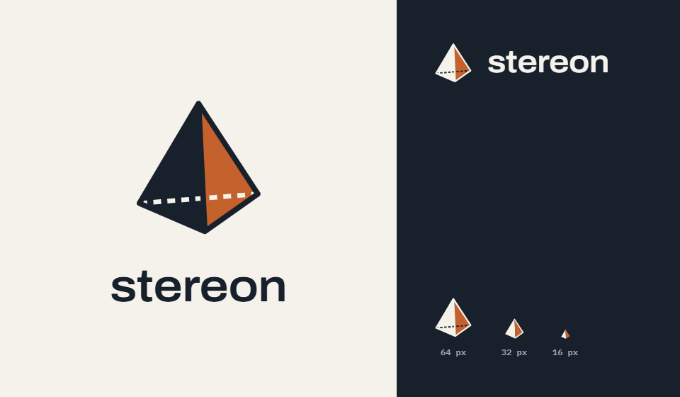

.. SPDX-FileCopyrightText: 2026 Onur Tuncer and Stereon contributors
.. SPDX-License-Identifier: MPL-2.0
..
.. This Source Code Form is subject to the terms of the Mozilla Public
.. License, v. 2.0. If a copy of the MPL was not distributed with this
.. file, You can obtain one at https://mozilla.org/MPL/2.0/.

.. _mainpage:

Stereon
=======

**A modern C++26 boundary-representation (B-rep) geometric modeling kernel.**

.. note::

   Stereon is pre-alpha software at version 0.1.0, the v0.1 "Geometry"
   release; v0.2 "Intersections" is in progress. Its APIs change between
   minor versions until 1.0. :doc:`intro` says what exists today and how
   this manual is organised; chapters still being written are listed under
   *Open documentation tasks* below. The design decisions are recorded as
   ADRs in `docs/adr <https://github.com/onurtuncer/Stereon/tree/main/docs/adr>`_.

.. toctree::
   :maxdepth: 2
   :caption: Getting started

   intro
   building
   examples

.. toctree::
   :maxdepth: 2
   :caption: Kernel guide

   architecture
   tolerances
   predicates
   geometry
   analytic
   nurbs
   trimmed
   swept
   interchange
   fitting
   properties
   sensitivity
   performance
   topology
   intersection
   modeling
   imprinting
   meshing
   data_exchange
   errors

.. toctree::
   :maxdepth: 2
   :caption: Reference

   python
   api
   testing
   debugging
   references

Planning
--------

The proposed capability baseline and its commit-pinned repository audit are
maintained in the `planning index
<https://github.com/onurtuncer/Stereon/tree/main/docs/planning>`_.
They describe the long-term coverage target and do not replace the ADRs.
The `roadmap and versioning plan
<https://github.com/onurtuncer/Stereon/blob/main/docs/planning/roadmap-and-versioning.md>`_
maps modelling milestones to product releases and separates native-format
and C ABI compatibility policies.

Open documentation tasks
------------------------

.. todolist::

* :ref:`genindex`
