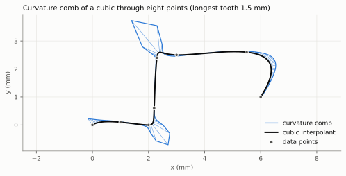
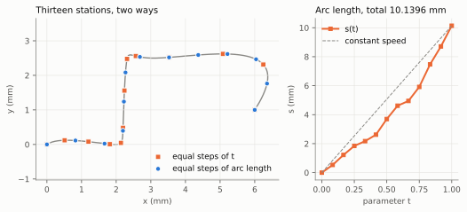

.. SPDX-FileCopyrightText: 2026 Onur Tuncer and Stereon contributors
.. SPDX-License-Identifier: MPL-2.0
..
.. This Source Code Form is subject to the terms of the Mozilla Public
.. License, v. 2.0. If a copy of the MPL was not distributed with this
.. file, You can obtain one at https://mozilla.org/MPL/2.0/.

Differential properties and arc length
======================================

Once a curve or surface can be evaluated and differentiated, a modelling
kernel asks the questions of differential geometry about it: which way it
runs, how sharply it bends, how it twists out of a plane, how long it is,
and where it is a given distance along. These are the interrogation
functions of OCCT's ``GeomLProp`` and ``GCPnts_AbscissaPoint``. Stereon
computes all of them from ``Deriv`` alone, so they work on every curve and
surface type: the built-in ones, the erased ``Curve``, ``Curve2d`` and
``Surface``, and a user's own type. A property is as accurate as the
derivatives it is computed from.

The theory is classical; do Carmo :cite:p:`docarmo1976differential` derives
everything used here, and Patrikalakis and Maekawa
:cite:p:`patrikalakis2002shape` treat it with CAD in mind.

Curves
------

Let :math:`\mathbf C(t)` be a regular curve, :math:`\mathbf C'(t) \ne 0`.
Its *unit tangent* is

.. math::

   \mathbf T = \frac{\mathbf C'}{\norm{\mathbf C'}}.

The parameter is arbitrary, so every property is defined to be independent
of it: reparametrising the curve changes :math:`\mathbf C'` and
:math:`\mathbf C''` but not the quantities below. In terms of the arc
length :math:`s`, with :math:`ds/dt = \norm{\mathbf C'}`, the *curvature*
is :math:`\kappa = \norm{d\mathbf T/ds}`, the rate at which the tangent
turns, and in terms of the given parameter

.. math::

   \kappa = \frac{\norm{\mathbf C' \times \mathbf C''}}{\norm{\mathbf C'}^3}.

A circle of radius :math:`r` has :math:`\kappa = 1/r`, a line
:math:`\kappa = 0`. Where :math:`\kappa > 0` the *principal normal*
:math:`\mathbf N` is the unit vector along :math:`d\mathbf T/ds`, towards
the centre of curvature :math:`\mathbf C + \mathbf N/\kappa`, the centre of
the *osculating circle* that matches the curve to second order. It is the
part of :math:`\mathbf C''` perpendicular to :math:`\mathbf C'`,

.. math::

   \mathbf N \parallel \mathbf C'' -
   \frac{\mathbf C'' \cdot \mathbf C'}{\mathbf C' \cdot \mathbf C'}\, \mathbf C',

but subtracting that projection can leave roundoff even for a straight
curve with nonconstant speed. ``PrincipalNormal`` instead checks the cross
product of the first two derivatives and constructs the normal as
:math:`\mathbf B \times \mathbf T`, consistently with ``FrenetFrame``.
A zero cross product returns ``DegenerateResult``. With the *binormal*
:math:`\mathbf B = \mathbf T \times \mathbf N`, the three vectors form the
Frenet frame, and the *torsion* :math:`\tau` measures how fast the
osculating plane, spanned by :math:`\mathbf T` and :math:`\mathbf N`, turns
about the tangent:

.. math::

   \tau = \frac{(\mathbf C' \times \mathbf C'') \cdot \mathbf C'''}
               {\norm{\mathbf C' \times \mathbf C''}^2}.

A plane curve has :math:`\tau = 0`; the circular helix
:math:`(r \cos t, r \sin t, c\, t)` has the constant
:math:`\kappa = r/(r^2 + c^2)` and :math:`\tau = c/(r^2 + c^2)`, which the
tests check.

In the plane, the cross product of two vectors is a number, and the same
formula gives the *signed* curvature

.. math::

   \kappa = \frac{\mathbf C' \times \mathbf C''}{\norm{\mathbf C'}^3},

positive where the curve turns counter-clockwise. ``Curvature`` of a
``Curve2d`` is signed in this way; of a curve in space it is never negative.

.. code-block:: cpp

   import Stereon.Curve;
   using namespace Stereon;

   const Result<double> kappa = Curvature(curve, t);        // 1/mm
   const Result<Vec3> normal = PrincipalNormal(curve, t);   // unit
   const Result<double> tau = Torsion(curve, t);            // 1/mm
   const Result<Point3> centre = CenterOfCurvature(curve, t);

   // T, N, B and the curvature from one evaluation of C, C' and C''.
   const Result<FrenetFrameResult> frame = FrenetFrame(curve, t);

.. _fig-properties-comb:

         from the curve, evenly spaced along it, pointing away from the
         centre of curvature, each as long as the curvature there relative
         to the largest; the tips are joined by a line.

   The curvature comb, the standard picture of a curve's fairness in CAD:
   at stations evenly spaced in arc length (``ParameterAtArcLength``), a
   tooth of length proportional to :math:`\kappa`, drawn away from the
   centre of curvature. The comb comes from ``Curvature`` and
   ``PrincipalNormal`` on the cubic interpolant of :numref:`fig-fitting-parametrization`
   (uniform parameters). The comb is continuous because a cubic is
   :math:`C^2`; its kinks at the knots show where the third derivative
   jumps.

Undefined properties
~~~~~~~~~~~~~~~~~~~~

Each property divides by something that can vanish. The tangent and the
curvature need :math:`\mathbf C' \ne 0`: a B-spline with two coincident
poles stops along a whole span, and the cusp of a curve stops at a point.
The principal normal, the torsion and the centre of curvature also need
:math:`\kappa \ne 0`: on a line, or at an inflection, the osculating plane
does not exist. In those cases the functions return
``ErrorCode::DegenerateResult`` instead of an arbitrary vector.

The tests for zero are exact. Near a stop or an inflection a property is
ill-conditioned, the normal turning through large angles for small changes
of :math:`t`, but it is still the property of the curve as represented, and
a caller who needs a margin knows its scale; the kernel does not hide one
(ADR-0028).

Arc length
----------

The length of the curve between two parameters is

.. math::

   s(a, b) = \int_a^b \norm{\mathbf C'(t)}\, dt,

which has no closed form even for an ellipse, whose perimeter is a complete
elliptic integral of the second kind, :math:`4 a\, E(e)`. ``ArcLength``
computes it by *adaptive Gauss–Legendre quadrature*
:cite:p:`davis1984numerical`.

The :math:`n`-point Gauss–Legendre rule on :math:`[-1, 1]`,

.. math::

   \int_{-1}^{1} f(x)\, dx \approx \sum_{i=1}^{n} w_i\, f(x_i),

takes the nodes :math:`x_i` at the roots of the Legendre polynomial
:math:`P_n` and integrates every polynomial of degree up to :math:`2n - 1`
exactly; for an analytic integrand its error decays geometrically with
:math:`n`. Stereon uses :math:`n = 16`. The nodes are computed once, when
first needed, by Newton's method on :math:`P_n` from the classical initial
guesses :math:`\cos(\pi (i - 1/4)/(n + 1/2))`, with weights
:math:`w_i = 2 / ((1 - x_i^2)\, P_n'(x_i)^2)`; no sixteen-digit constants
are written into the source (ADR-0024).

The speed :math:`\norm{\mathbf C'}` of a B-spline is smooth inside each
knot span but has kinks at the knots, where higher derivatives jump, and a
rule of high order converges slowly across a kink. ``ArcLength`` therefore
splits the range at the distinct knots first. On each piece it compares the
one-piece value with the sum of the two halves; if they agree to a relative
:math:`2^{-40} \approx 10^{-12}` of the length so far, it accepts the
halves, otherwise it recurses into each half. The differences of the
accepted pieces add up to ``ErrorEstimate``, which
``ArcLength`` returns with the length: an estimate of the achieved error,
reported rather than assumed (ADR-0028). It is an estimate, not a bound,
since the two-piece value is itself approximate.

A periodic curve, such as a circle or an ellipse, accepts any finite range,
and its length counts every turn the range covers. Any other curve requires
the range to lie inside its domain; an unbounded range is ``InvalidInput``.

Point at a given length
~~~~~~~~~~~~~~~~~~~~~~~

``ParameterAtArcLength(curve, start, length)`` inverts the arc length: it
returns the parameter :math:`t` with :math:`s(\mathrm{start}, t) =
\mathrm{length}`, going backwards for a negative length. Since
:math:`s` is non-decreasing in :math:`t` with derivative
:math:`\norm{\mathbf C'(t)}`, Newton's method

.. math::

   t_{k+1} = t_k - \frac{s(\mathrm{start}, t_k) - \mathrm{length}}
                        {\norm{\mathbf C'(t_k)}}

converges quadratically near the root. It is kept safe by a bracket on
which :math:`s - \mathrm{length}` changes sign: every iterate shrinks the
bracket, and a step that would leave it, or a point where the curve stops,
bisects instead. The first bracket ends at the domain end in the direction
of travel; a periodic curve, or one with an unbounded domain, is followed
as far as the length needs, so a circle can be walked round several times.
Where the curve stops along a whole stretch, :math:`s` is constant there
and any parameter of the stretch is an answer. Stagnation and exhaustion
of the iteration budget return ``Unresolved`` unless the relative length
residual target has been met; a small parameter step alone is not success.

Each Newton step integrates the length afresh, so a station costs a few
arc-length evaluations. Placing many stations, a common task for meshing
an edge, is cheaper by walking from the previous one, which keeps every
integral short.

.. _fig-properties-arclength:

         parameter steps, bunched where the curve is slow, and thirteen
         round markers evenly spaced along it. Right: arc length s plotted
         against the parameter t, a curve that departs from the dashed
         straight line of constant speed.

   A uniform parameter is not a uniform distance. Left: stations at equal
   steps of :math:`t` (squares) crowd where the curve is slow, at its
   sharp turn; stations from ``ParameterAtArcLength`` at equal steps of
   :math:`s` (circles) are evenly spaced. Right: :math:`s(t)` against the
   straight line it would follow at constant speed.

Surfaces
--------

Let :math:`\mathbf S(u, v)` be a regular surface,
:math:`\mathbf S_u \times \mathbf S_v \ne 0`. ``UnitNormal`` returns

.. math::

   \mathbf n = \frac{\mathbf S_u \times \mathbf S_v}{\norm{\mathbf S_u \times \mathbf S_v}},

and the orientation of the surface is the orientation of this normal:
``Reversed`` turns it round, and every built-in analytic surface documents
which way it points (out of a sphere, cylinder, cone or torus in a
right-handed frame).

The fundamental forms
~~~~~~~~~~~~~~~~~~~~~

A tangent vector :math:`\mathbf S_u\, du + \mathbf S_v\, dv` has squared
length given by the *first fundamental form*

.. math::

   \mathrm I = E\, du^2 + 2F\, du\, dv + G\, dv^2, \qquad
   E = \mathbf S_u \cdot \mathbf S_u,\;
   F = \mathbf S_u \cdot \mathbf S_v,\;
   G = \mathbf S_v \cdot \mathbf S_v,

the metric of the surface. How fast the surface leaves its tangent plane in
that direction is the *second fundamental form*

.. math::

   \mathrm{II} = L\, du^2 + 2M\, du\, dv + N\, dv^2, \qquad
   L = \mathbf S_{uu} \cdot \mathbf n,\;
   M = \mathbf S_{uv} \cdot \mathbf n,\;
   N = \mathbf S_{vv} \cdot \mathbf n.

``FundamentalForms`` returns the six coefficients and the normal they refer
to. A curve on the surface through the point, in the tangent direction
:math:`(du, dv)`, has *normal curvature* :math:`\kappa_n = \mathrm{II} /
\mathrm I` (Meusnier): the component along :math:`\mathbf n` of its
curvature vector, the same for every such curve.

Principal, Gaussian and mean curvature
~~~~~~~~~~~~~~~~~~~~~~~~~~~~~~~~~~~~~~

As the direction turns, :math:`\kappa_n` ranges between two extremes, the
*principal curvatures* :math:`\kappa_1 \le \kappa_2`, reached in two
orthogonal *principal directions* (Euler). They are the eigenvalues and
eigenvectors of the shape operator :math:`\mathrm I^{-1} \mathrm{II}`,
whose determinant and half-trace are the *Gaussian* and *mean* curvatures

.. math::

   K = \kappa_1 \kappa_2 = \frac{LN - M^2}{EG - F^2}, \qquad
   H = \frac{\kappa_1 + \kappa_2}{2} = \frac{EN - 2FM + GL}{2\,(EG - F^2)},

so that :math:`\kappa_{1,2} = H \mp \sqrt{H^2 - K}`. The subtraction in
that formula cancels when :math:`\abs{H} \gg \sqrt{H^2 - K}`, so
``PrincipalCurvatures`` computes the root of larger magnitude,
:math:`H + \operatorname{sign}(H) \sqrt{H^2 - K}`, and the other as
:math:`K` divided by it. The discriminant :math:`H^2 - K` is never negative
in exact arithmetic; at an *umbilic*, where :math:`\kappa_1 = \kappa_2` and
every direction is principal, rounding can push it slightly below zero, and
it is clamped.

A principal direction :math:`(du, dv)` for :math:`\kappa` is a null vector
of the symmetric matrix :math:`\mathrm{II} - \kappa\, \mathrm I`; Stereon
takes it from whichever row of that matrix is larger, maps it to
:math:`\mathbf S_u\, du + \mathbf S_v\, dv` and normalises it, and sets the
other direction to complete a right-handed frame,
:math:`\mathbf d_1 \times \mathbf d_2 = \mathbf n`. At an umbilic the pair
is an arbitrary orthonormal one, as it should be.

The sign of every curvature but :math:`K` follows the normal: a curvature
is positive where the surface bends *towards* :math:`\mathbf n`. A sphere of
radius :math:`R` with its outward normal therefore has
:math:`\kappa_1 = \kappa_2 = -1/R`, :math:`H = -1/R` and :math:`K = 1/R^2`;
reversed, its principal and mean curvatures become :math:`+1/R`, while
:math:`K` does not change. The tests also check the cylinder,
:math:`(-1/R, 0)` with the zero along the axis, and the torus, whose
Gaussian curvature :math:`\cos v / (r (R + r \cos v))` is positive on the
outside, negative on the inside and zero on the top and bottom circles.

The same quantities are invariant under reparametrisation, which gives a
strong test: the exact NURBS form of a torus (:doc:`nurbs`) is parametrised
quite differently, by rational quadratic arcs, yet at each point it has the
torus's principal curvatures to the accuracy of the projection that finds
the point.

.. code-block:: cpp

   import Stereon.Surface;
   using namespace Stereon;

   const Result<PrincipalCurvaturesResult> k = PrincipalCurvatures(surface, uv);
   if (k) {
       // k->Min <= k->Max, k->MinDirection x k->MaxDirection = normal
   }
   const Result<double> gauss = GaussianCurvature(surface, uv);

At a pole of a sphere or the apex of a cone, :math:`\mathbf S_u \times
\mathbf S_v = 0`: the parametrisation is singular there even though the
sphere itself is smooth. Every surface property returns
``DegenerateResult`` at such a point. The normal at a pole has a limit, and
a future version may return the limit where it exists, as OCCT does
(ADR-0009 calls these edges *Degenerate*).

Related design decisions
------------------------

- `ADR-0006: Error handling <https://github.com/onurtuncer/Stereon/blob/main/docs/adr/0006-error-handling.md>`_
- `ADR-0024: Named constants <https://github.com/onurtuncer/Stereon/blob/main/docs/adr/0024-named-constants.md>`_
- `ADR-0028: Separate numerical tolerances by purpose <https://github.com/onurtuncer/Stereon/blob/main/docs/adr/0028-purpose-specific-numerical-tolerances.md>`_
